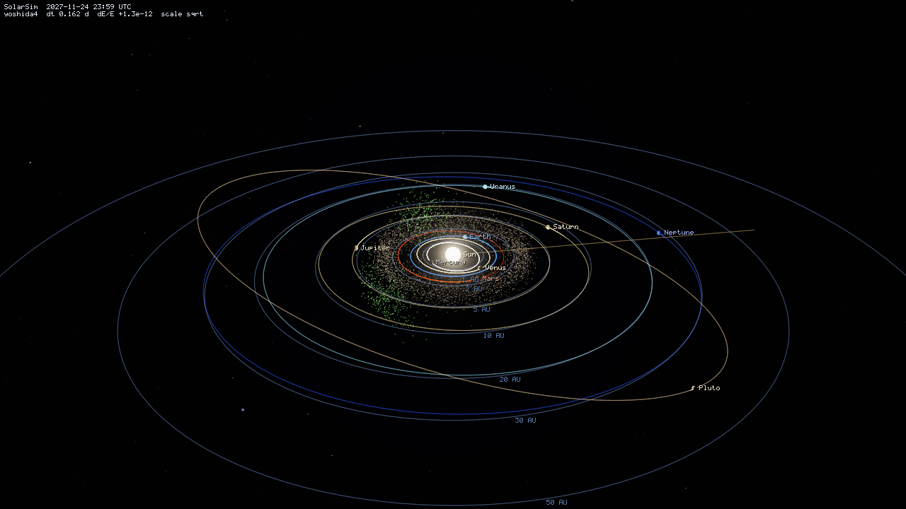
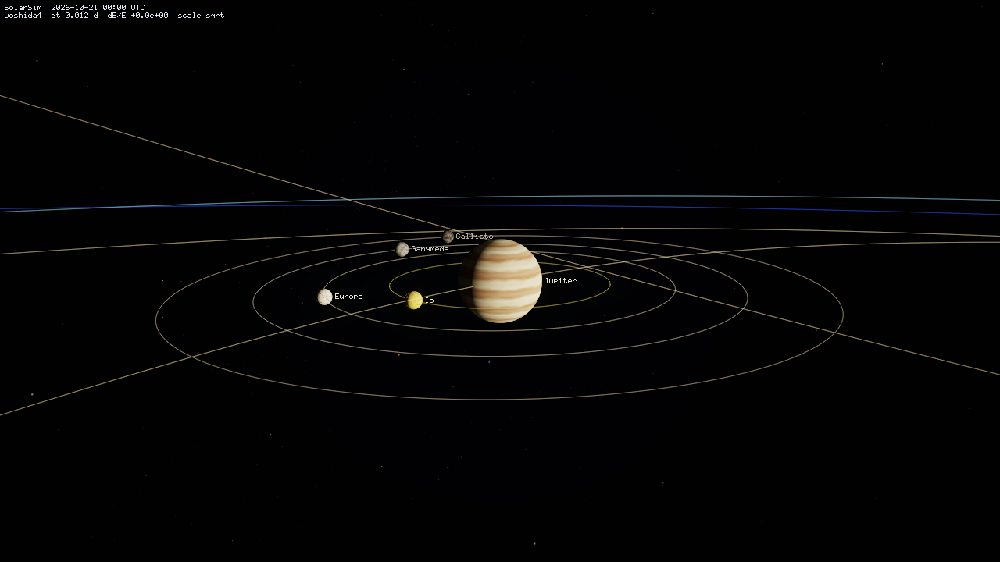
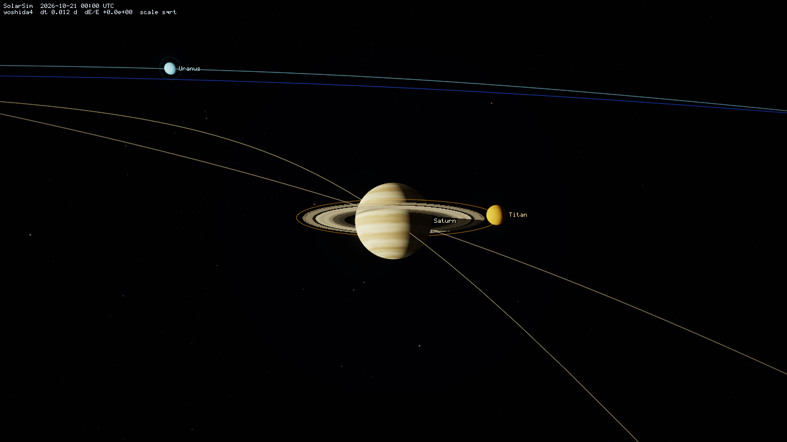
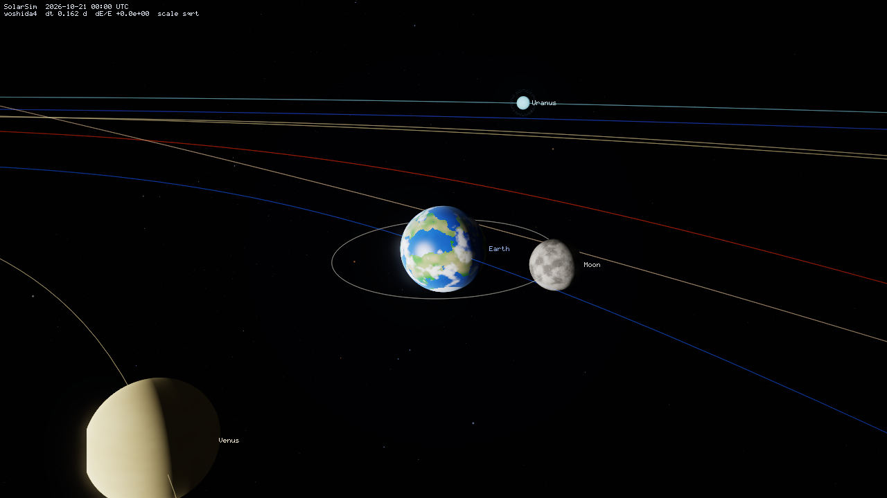
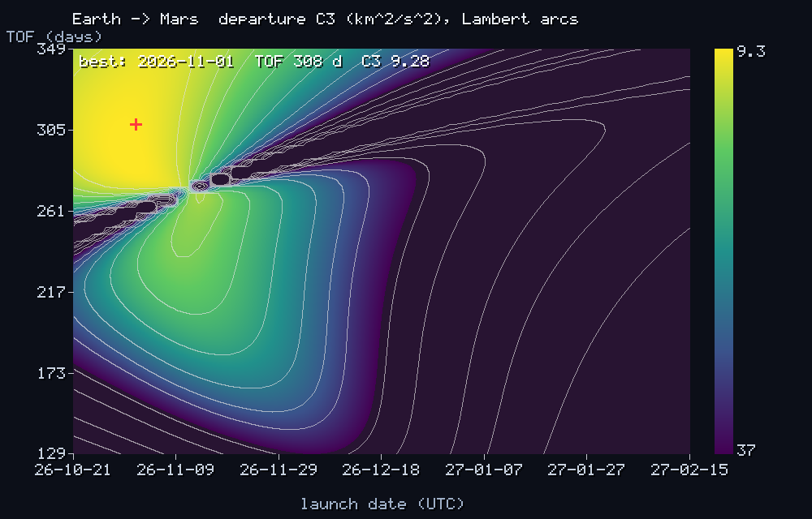
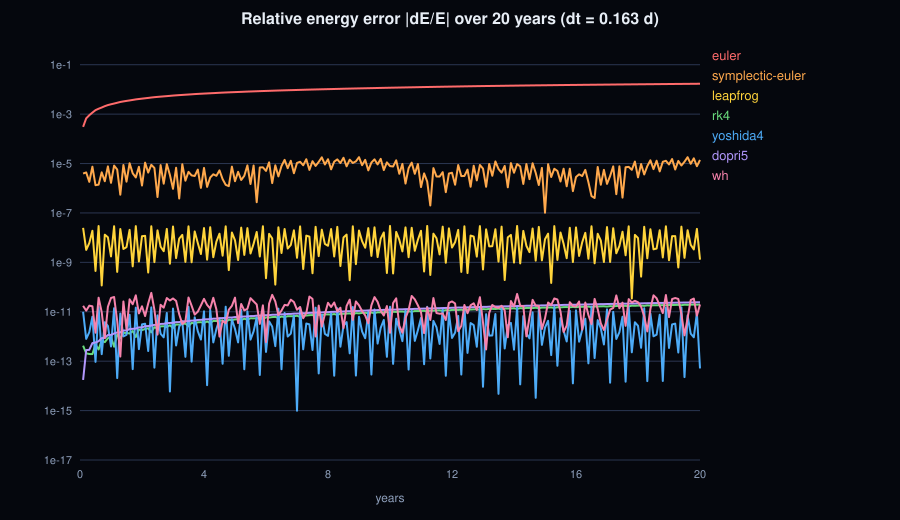

# SolarSim

**An N-body Solar System simulator in modern C++17, built on real physics and real data, with no third-party dependencies.**

SolarSim integrates the gravitational motion of the Sun, planets, moons, comets and thousands of
asteroids from **real initial conditions** (JPL/IAU data), then lets you watch the result live in your
terminal, render animations and images, and check it against the real sky. Published equinox times,
eclipse new moons and planetary oppositions come out within minutes, and the general-relativistic
precession of Mercury matches Einstein's prediction.

Everything is written from scratch in standard C++17: vector math, integrators, Kepler/Lambert solvers,
a software ray-casting renderer, a DEFLATE compressor for PNG, an LZW encoder for GIF, a terminal UI,
a CLI parser, a thread pool and a unit-test framework. The only build requirement is a C++17 compiler.
(The optional [OpenGL experiments](#opengl-experiments) are the one exception: they use SDL2.)



| Jupiter + Galilean moons | Saturn's rings (Cassini division, ring shadow) | Earth-Moon system |
|---|---|---|
|  |  |  |

---

## Contents

1. [Quick start](#quick-start)
2. [Building](#building) (Linux, macOS, Windows)
3. [Commands](#commands)
4. [Interactive viewer](#interactive-viewer)
5. [Physics and data](#physics-and-data)
6. [Validation against the real sky](#validation-against-the-real-sky)
7. [Custom bodies](#custom-bodies-data-files)
8. [OpenGL experiments](#opengl-experiments)
9. [Project layout](#project-layout)
10. [Contributing](#contributing)
11. [Troubleshooting](#troubleshooting)

Further reading: [`docs/PHYSICS.md`](docs/PHYSICS.md) (equations and algorithms) and
[`docs/ARCHITECTURE.md`](docs/ARCHITECTURE.md) (code structure and extension points).

---

## Quick start

```bash
# Linux / macOS
./build.sh                 # CMake, Make or a direct compiler call, whichever is available
./build/solarsim           # starts the interactive 3D view in your terminal (q to quit)
```

```bat
:: Windows (Developer Command Prompt for Visual Studio, or MinGW g++ on the PATH)
build.bat
build\Release\solarsim.exe
```

Some things to try:

```bash
solarsim selftest                                   # 14 quick sanity checks
solarsim validate                                   # compare against published astronomical dates
solarsim events                                     # the next year's equinoxes, moon phases, oppositions...
solarsim ephem --lat 51.48 --lon 0.0                # what is in the sky right now (alt/az)
solarsim render --out solar.gif --asteroids 3000    # animated GIF
solarsim mission --porkchop porkchop.png            # plan an Earth -> Mars transfer
solarsim precession                                 # Mercury and general relativity
solarsim help                                       # all commands and options
```

> When the output isn't a terminal (piped or redirected), running `solarsim` with no command prints the
> body table instead of starting the viewer, so the program always does something useful.

---

## Building

### Requirements

| | Minimum | Tested |
|---|---|---|
| C++ compiler | GCC 8, Clang 7, MSVC 2019 (16.x)¹, MinGW-w64 8 | GCC 13.3, Clang 18.1, MinGW-w64 GCC 13 (Windows .exe run under Wine) |
| Build tool (optional) | CMake 3.10 **or** GNU Make **or** nothing | CMake 3.28 |
| Libraries | none (standard library + threads only) | |

¹ The MSVC code paths (`build.bat`, `/utf-8`, Windows console API) follow the documented APIs but were
not compiled with MSVC during development. The Windows build was verified with MinGW-w64. If MSVC
reports anything, the MinGW route (MSYS2: `pacman -S mingw-w64-ucrt-x86_64-gcc`) is the fallback.

### Option A: CMake (recommended, all platforms)

```bash
cmake -S . -B build -DCMAKE_BUILD_TYPE=Release
cmake --build build -j
./build/solarsim                     # Windows/MSVC: build\Release\solarsim.exe
(cd build && ctest)                  # unit tests + selftest
```

Build types: `Release` (default, `-O2`/`-O3`), `Debug` (no optimisation, full symbols),
`RelWithDebInfo` (optimised with symbols), `MinSizeRel`.

CMake options:

| Option | Default | Meaning |
|---|---|---|
| `SOLARSIM_BUILD_TESTS` | `ON` | build `solarsim_tests` |
| `SOLARSIM_NATIVE` | `OFF` | `-march=native` |
| `SOLARSIM_WARNINGS_AS_ERRORS` | `OFF` | `-Werror` / `/WX` |

### Option B: Make (Linux, macOS, MSYS2)

```bash
make -j            # -> ./solarsim
make debug         # -> ./solarsim_debug (-O0 -g)
make tests         # builds and runs ./solarsim_tests
make CXX=clang++   # choose a compiler
```

### Option C: a single compiler command (no build tools at all)

```bash
g++ -std=c++17 -O2 -Isrc src/*/*.cpp src/main.cpp -o solarsim -pthread
```

On Windows with MinGW add `-D__USE_MINGW_ANSI_STDIO=1 -static`. With MSVC, from a Developer Command
Prompt, run `build.bat`, which collects the sources and calls `cl /std:c++17 /O2 /EHsc /utf-8`.

### Build variants

```bash
cmake -S . -B build-debug -DCMAKE_BUILD_TYPE=Debug            # symbols, no optimisation
cmake -S . -B build-rel   -DCMAKE_BUILD_TYPE=RelWithDebInfo   # optimised + symbols
strip -o solarsim_stripped build/solarsim                     # symbol-less release binary
```

These variants are handy if you want to compare how the same code looks at different optimisation
levels, for example in a debugger or disassembler.

The code compiles without warnings under `-Wall -Wextra -Wpedantic` (GCC and Clang). It is clean under
AddressSanitizer, UndefinedBehaviorSanitizer and ThreadSanitizer, and the Windows build (MinGW, static)
passes the full test suite.

---

## Commands

```
solarsim <command> [options]
```

| Command | What it does |
|---|---|
| `view` | Real-time interactive 3D view in the terminal (default when run in a terminal) |
| `render` | Render a GIF animation, PNG/BMP/PPM still or sequence, or SVG orbit diagram |
| `info` | Physical and orbital data of every body (`--body NAME` for a detailed card) |
| `ephem` | Apparent positions from Earth: RA/Dec, distance, magnitude, phase, alt/az |
| `events` | Equinoxes, solstices, moon phases, oppositions, conjunctions, elongations, perihelia |
| `mission` | Interplanetary transfer design: porkchop plot, N-body targeting, B-plane arrival |
| `precession` | Perihelion precession of Mercury (or any planet), Newtonian vs general relativity |
| `lagrange` | Lagrange points, Hill spheres, Routh stability and a test-particle experiment |
| `compare` | Benchmark all 7 integrators: energy error, accuracy against a reference, speed |
| `validate` | Compare simulated events against published dates and analytic solutions |
| `export` | CSV time series of state vectors and conservation diagnostics |
| `selftest` | Fast built-in sanity checks |

Run `solarsim help <command>` for command-specific examples.

### Common options

| Option | Description |
|---|---|
| `--epoch DATE` | start date: `2026-10-21`, `2026-10-21T13:45`, `JD2451545`, `J2000`, `now` (default) |
| `--integrator NAME` | `euler`, `symplectic-euler`, `leapfrog`, `rk4`, `yoshida4` (default), `dopri5`, `wh` |
| `--dt DAYS` | time step (default: automatic, about 1/150 of the shortest orbital period) |
| `--gr` | add the general-relativistic (1PN) correction from the Sun |
| `--moons` / `--minor` | add Io, Europa, Ganymede, Callisto, Titan, Triton / Ceres, Vesta, Halley, Encke |
| `--asteroids N` `--trojans N` `--kuiper N` | synthetic populations of test particles |
| `--intruder` | a passing star on a hyperbolic flyby (`--intruder-mass`, `-q`, `-vinf`, `-days`) |
| `--bodies FILE` | load extra bodies from INI files (see `data/`) |
| `--only LIST` / `--exclude LIST` | choose which bodies are simulated |
| `--calibrate none\|moon\|all` | differential correction of initial conditions (default `all`) |
| `--ascii` / `--markdown` | table style for text output |

### Examples

```bash
# Animations and images
solarsim render --out solar.gif --frames 240 --days-per-frame 3 --asteroids 3000 --trojans 600
solarsim render --out inner.gif --view inner --minor --width 800 --height 600
solarsim render --out saturn.png --focus Saturn --moons --width 1920 --height 1080
solarsim render --out jovian.gif --focus Jupiter --moons --days-per-frame 0.1 --frames 300
solarsim render --out flyby.gif --intruder --kuiper 4000 --view outer --scale log --days-per-frame 400
solarsim render --out orbits.svg --duration 4000
solarsim render --out frames/ --frames 600          # numbered PNG sequence (e.g. for ffmpeg)

# Astronomy
solarsim events --from 2026-01-01 --to 2028-01-01 --types planets
solarsim events --types moon --csv phases.csv
solarsim ephem --date "2026-08-12 17:30" --lat 43.36 --lon -5.85   # eclipse day, northern Spain

# Mission design
solarsim mission --origin Earth --target Mars --porkchop porkchop.png --plot transfer.svg
solarsim mission --origin Earth --target Venus --capture-alt 300

# Numerical experiments
solarsim compare --years 50 --plot energy.svg
solarsim precession --body Mercury --years 200
solarsim lagrange --pair Sun,Jupiter --test-years 200
solarsim view --integrator euler          # then press 'i' to switch integrators live

# Data export
solarsim export --out states.csv --duration 3650 --every 10 --frame helio --csv diagnostics.csv
```



---

## Interactive viewer

`solarsim view` draws the system in the terminal using 24-bit colour **half-block characters**
(two pixels per character cell), with a 256-colour mode and a pure-ASCII mode as fallbacks.

| Key | Action | Key | Action |
|---|---|---|---|
| `q` / `Esc` | quit | `space` | pause |
| arrows / `WASD` | rotate camera | `+` / `-` | zoom |
| `[` / `]` | slower / faster time | `r` | reverse time (the symplectic integrators are reversible!) |
| `Tab` | focus next body | `0`-`9` | focus Sun, Mercury … Pluto |
| `t` `o` `l` `g` `p` | trails, orbits, labels, grid, particles | `b` | bloom |
| `m` | radial scale (sqrt / log / linear) | `c` | colour mode |
| `i` | cycle integrator (watch Euler's energy drift!) | `e` | toggle general relativity |
| `x` | save a 1920×1080 PNG screenshot | `h` | help |
| `z` | reset camera | | |

Options: `--warp DAYS_PER_SECOND` (default 10), `--color truecolor|256|ascii`, `--target-fps N`,
`--focus BODY`, `--max-frames N` (exit after N frames, also allows non-interactive use).

---

## Physics and data

The full derivations are in [`docs/PHYSICS.md`](docs/PHYSICS.md). In short:

- **Units:** AU, days and gravitational parameters GM in AU³/day² (TDB time scale). Using GM
  instead of G·M is standard practice, because GM is measured to around 10 digits while G only to about 5.
- **Data:** GM values from the JPL **DE440** ephemeris, radii, rotation and pole orientations from the
  **IAU WGCCRE 2015** report, and planetary orbits from **Standish's JPL Keplerian elements**
  (Table 1, valid 1800–2050). The Moon comes from the **ELP-2000/82** lunar theory (Meeus ch. 47, about 120
  periodic terms). Bright stars use real J2000 positions, magnitudes and B−V colours.
- **Initial conditions:** each planet's orbit describes the barycentre of its subsystem, so the Earth
  and Moon are placed around the Earth–Moon barycentre and Jupiter around the Jovian barycentre. The
  system is shifted to the Solar System barycentre with zero total momentum. A **differential-correction
  step** then tunes each body's initial velocity so that its N-body mean motion matches the reference
  theory (`dn/n = −3 dv/v`). This takes the Moon from roughly 2 hours of drift per year to about 1 minute.
- **Forces:** Newtonian point-mass gravity with direct O(N²) summation for massive bodies and
  O(N·N_massive) for test particles (multi-threaded). Optional **1PN general relativity**
  (Schwarzschild, harmonic gauge) from the Sun, and optional Plummer softening.
- **Integrators:**

| Name | Order | Symplectic | Notes |
|---|---|---|---|
| `euler` | 1 | no | textbook example of energy drift |
| `symplectic-euler` | 1 | yes | kick–drift |
| `leapfrog` | 2 | yes | Störmer–Verlet drift–kick–drift, time-reversible |
| `rk4` | 4 | no | classical Runge–Kutta, slow secular energy drift |
| `yoshida4` | 4 | yes | **default**, Yoshida (1990) triple-jump composition |
| `dopri5` | 5(4) | no | Dormand–Prince with adaptive step-size control |
| `wh` | 2 | yes | Wisdom–Holman map, democratic heliocentric coordinates, exact Kepler drift via universal variables |

- **Astronomy:** time scales (UTC, TT, ΔT), IAU 1976 precession, IAU 1980 nutation, light-time
  correction, annual aberration, topocentric parallax, atmospheric refraction and visual magnitudes
  (including Saturn's ring tilt).
- **Analysis:** event finding with Brent root-finding and golden-section search on re-integrated
  snapshots, Lagrange points (quintic plus Routh criterion), Lambert solver and porkchop plots,
  Newton single-shooting with finite-difference Jacobians, B-plane targeting, and least-squares
  precession rates.
- **Rendering:** per-pixel ray-cast spheres with procedural surfaces (gas-giant bands with the Great Red
  Spot, Earth's continents, clouds and ocean glint, ice caps), solar limb darkening, atmospheres, Saturn's
  ring structure with mutual ring/planet shadows, comet ion and dust tails, osculating orbits, trails,
  a star field with the Milky Way in the correct place, HDR bloom and ACES tone mapping. A radial
  distance compression keeps Mercury and Neptune visible in the same frame.



---

## Validation against the real sky

`solarsim validate` (simulation starting 2023-06-01) gives, against published times:

| Quantity | Typical error |
|---|---|
| Equinoxes and solstices 2024–2026 (12 events) | mean **6 min** (max 12.5 min) |
| Full/new moons 2024–2026, including the 2024-04-08 and 2026-08-12 solar eclipses | mean **1.3 min** |
| Oppositions of Mars, Jupiter, Saturn and Venus inferior conjunction | ≤ 0.45 day |
| Mercury's relativistic perihelion advance | **42.980″/century** (Einstein: 42.980″) |
| Mercury's total perihelion advance (inertial frame) | 572″/cy (literature ≈ 575″/cy) |
| Energy conservation, 50 years, `yoshida4` | \|ΔE/E\| ≈ 2·10⁻¹¹ |
| Two-body integration vs the analytic Kepler solution, 10 years | 1.6 km |

Some more physics you can reproduce:

- **Trojans:** `--asteroids 4000 --trojans 800` shows the Trojans librating around Jupiter's L4 and L5
  points. The main belt is seeded with the Kirkwood gaps at Jupiter's 4:1, 3:1, 5:2, 7:3 and 2:1
  resonances, and the Kuiper belt with plutinos in Neptune's 3:2 resonance.
- **Lagrange stability:** `lagrange --pair Sun,Jupiter --test-years 100`. Particles at L1, L2 and L3
  escape, while those at L4 and L5 librate within about 11°.
- **Laplace resonance:** Io, Europa and Ganymede start with λ₁ − 3λ₂ + 2λ₃ = 180°.
- **Retrograde orbits:** Triton (`--moons`) and Halley (`--minor`).
- **Hyperbolic orbits:** ʻOumuamua and Borisov (`--bodies data/comets.ini`).

---

## Custom bodies (data files)

Add any body with an INI file and `--bodies file.ini` (comma-separate several files). Documented
examples:

- [`data/comets.ini`](data/comets.ini): Hale-Bopp, Swift-Tuttle, Tempel-Tuttle, ʻOumuamua, Borisov
- [`data/hypothetical.ini`](data/hypothetical.ini): Le Verrier's *Vulcan* and *Planet Nine*
- [`data/mars_moons.ini`](data/mars_moons.ini): Phobos and Deimos in Mars' equatorial frame

```ini
[body]
name   = Hale-Bopp
kind   = comet            ; planet | dwarf | moon | asteroid | comet | spacecraft
q      = 0.914            ; perihelion [AU]  (or a = semi-major axis)
e      = 0.995086
i      = 89.43            ; degrees, ecliptic J2000
node   = 282.47
argp   = 130.59
tp     = 1997-04-01T03:21 ; perihelion time (or M/L + epoch)
radius_km = 30            ; optional: mass_kg / mass_earths / gm_km3s2, color, style, rings...
```

---

## OpenGL experiments

`experiments/` holds a step-by-step exploration of a GPU-accelerated viewer, built with SDL2 and
OpenGL 3.3 core. These programs are **not** part of the main build (CMake, Make and `build.sh` ignore
them) and are the only code in the repository with a third-party dependency.

| File | What it adds |
|---|---|
| `hello_gl.cpp` | open a window and a 3.3 core context, print the GL version/renderer |
| `step2.cpp` | first shader program and vertex buffer: a coloured triangle |
| `step3.cpp` | 3D: model-view-projection matrix, index buffer, depth test (spinning cube) |
| `step4.cpp` | a generated sphere mesh reused for a toy Sun and planets |
| `step5.cpp` | point lighting from the Sun with inverse-square falloff, emissive Sun |
| `opengl/step6.cpp` | **the real simulation**: SolarSim's `Simulation`, display mapping and orbit camera on the GPU |
| `opengl/step7.cpp` | orbit trails (line strips), star field (points at infinity), on-screen legend |
| `opengl/step8.cpp` | HDR rendering: multisampled float framebuffer, bright pass, ping-pong Gaussian bloom, exposure, tone mapping (clamp / Reinhard / ACES), gamma |

Building (needs SDL2: `brew install sdl2` on macOS, `apt install libsdl2-dev` on Debian/Ubuntu):

```bash
# steps 1-5: standalone, one file each
clang++ -std=c++17 experiments/step5.cpp $(sdl2-config --cflags --libs) -framework OpenGL -o step5

# steps 6-8: link against the SolarSim sources
clang++ -std=c++17 -O2 -Isrc experiments/opengl/step8.cpp \
    src/core/*.cpp src/astro/*.cpp src/physics/*.cpp src/render/*.cpp \
    $(sdl2-config --cflags --libs) -framework OpenGL -o step8
./step8                        # --frames N exits after N frames
```

On Linux replace `-framework OpenGL` with `-lGL` (and `clang++` with `g++` if you prefer).

Controls in steps 6–8:

| Key | Action | Key | Action |
|---|---|---|---|
| left drag / wheel | orbit / zoom | `Esc` / `q` | quit |
| `Tab` / `0`-`9` | focus body | `z` | reset camera |
| `space` | pause | `[` / `]` | slower / faster time |
| `r` | reverse time | `f` | display flux / physical flux |
| `m` | radial scale (sqrt / log / linear) | `t` / `s` | trails / stars (step 7+) |
| `h` | legend (step 7+) | `,` / `.` | exposure down / up (step 8) |
| `y` | tone map: clamp / Reinhard / ACES (step 8) | `b`, `-` / `=` | bloom on/off, weaker / stronger (step 8) |

---

## Project layout

```
solarsim/
├── CMakeLists.txt  Makefile  build.sh  build.bat
├── src/
│   ├── main.cpp                 entry point and command dispatch
│   ├── core/       (1.8k lines) vectors, matrices, root finders, RNG, CLI and INI parsers, tables, thread pool
│   ├── astro/      (1.8k)       time scales, Kepler and Lambert solvers, orbital elements, frames,
│   │                            body catalogue (DE440, IAU), ELP-2000/82 lunar theory
│   ├── physics/    (2.1k)       N-body system, force models, 7 integrators, simulation driver,
│   │                            system builder, populations, differential-correction calibration
│   ├── analysis/   (1.3k)       observations, event finder, Lagrange points, mission design, precession
│   ├── render/     (2.5k)       camera, ray-cast scene renderer, surfaces, star field, bloom/tone map,
│   │                            bitmap font, ANSI terminal renderer
│   ├── io/         (1.4k)       DEFLATE/zlib, PNG, BMP, PPM, GIF (median cut + LZW), SVG, CSV, body files
│   ├── platform/   (0.4k)       raw terminal I/O for POSIX and Windows, signals, directories
│   └── app/        (2.4k)       one file per command
├── tests/          (1.1k)       dependency-free test framework + 45 tests (incl. independent inflate/LZW decoders)
├── data/                        example body files
├── docs/                        PHYSICS.md, ARCHITECTURE.md, images
├── experiments/                 SDL2 + OpenGL viewer experiments (not built by default)
│   └── opengl/                  steps 6-8, built on the SolarSim sources
├── scripts/                     demo.sh (runs everything into ./out), gen_font.py
└── .githooks/                   pre-commit hook that blocks binary files
```

About 14,800 lines of C++ in 119 files, plus about 3,000 lines of OpenGL experiments.

---

## Contributing

The repository ships a pre-commit hook that refuses commits containing binary files (images under
`docs/images/` are allowed), so build outputs and screenshots don't end up in history. Enable it once
per clone:

```bash
git config core.hooksPath .githooks
```

---

## Troubleshooting

| Symptom | Fix |
|---|---|
| Garbled box characters or `─` in tables (old Windows console) | use Windows Terminal, or add `--ascii` |
| No colours / escape codes visible in the viewer | `--color 256` or `--color ascii` |
| Viewer looks squashed | enlarge the terminal (100×30 or more works well) |
| `view` says it needs a terminal | output is redirected; use `render`, or add `--max-frames N` |
| Moons don't show in the overview | they are hidden while they would overlap the planet; focus it (`--focus Jupiter`) or zoom in |
| Very slow with `--moons` | Io's 1.8-day orbit forces a ~17-minute step; lower `--warp` or use `--integrator wh` |
| GIF too large | reduce `--width/--height/--frames`; `--dither` improves gradients |
| Dates far outside 1800–2050 | the Standish elements are only accurate in that range (the integration still works) |

## License

MIT. See [LICENSE](LICENSE). Astronomical constants and algorithms are from the cited public scientific
literature (JPL, IAU, Meeus, Standish). The bitmap font was drawn for this project.
